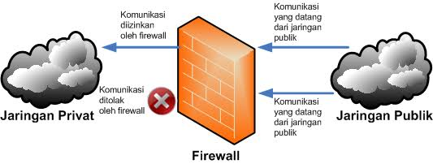
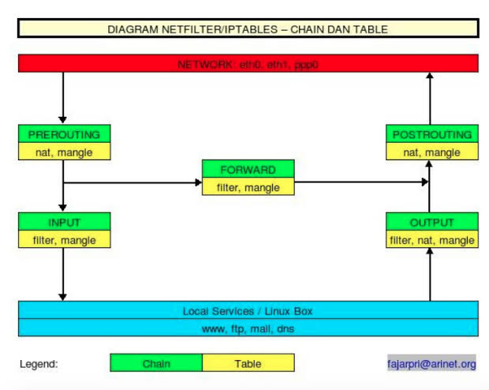
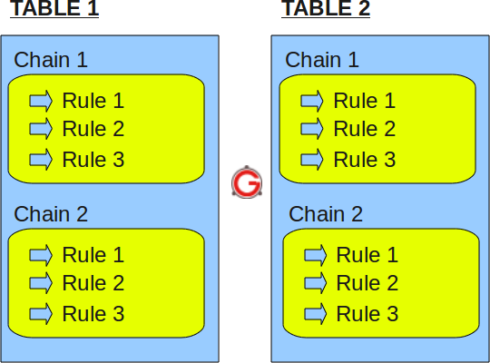
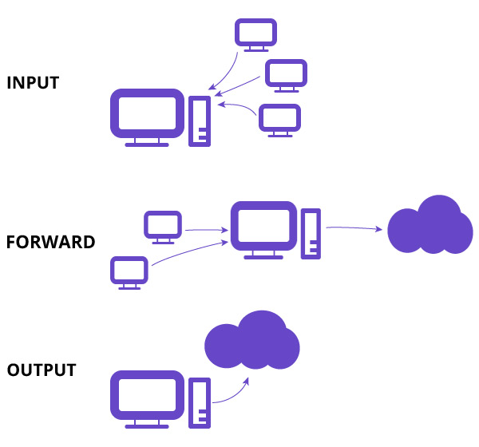
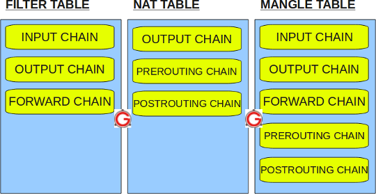
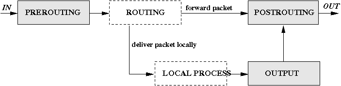

# Firewall

## Daftar Isi

- [1. Pendahuluan](#1-pendahuluan)
  - [1.1 Gambaran Materi](#11-gambaran-materi)
  - [1.2 Tujuan Pembelajaran](#12-tujuan-pembelajaran)
- [2. Definisi Firewall](#2-definisi-firewall)
- [3. Fungsi Firewall](#3-fungsi-firewall)
- [4. Cara Kerja Firewall](#4-cara-kerja-firewall)
  - [4.1 Ilustrasi](#41-ilustrasi)
  - [4.2 Cara Firewall Melindungi Jaringan](#42-cara-firewall-melindungi-jaringan)
  - [4.3 Dari Paket Menjadi Keputusan](#43-dari-paket-menjadi-keputusan)
  - [4.4 Strategi: Default Allow dan Default Deny](#44-strategi-default-allow-dan-default-deny)
  - [4.5 Posisi Firewall pada Jaringan](#45-posisi-firewall-pada-jaringan)
- [5. Jenis-Jenis Firewall](#5-jenis-jenis-firewall)
- [6. Netfilter dan iptables](#6-netfilter-dan-iptables)
  - [6.1 Netfilter, iptables, dan nftables](#61-netfilter-iptables-dan-nftables)
  - [6.2 Struktur iptables](#62-struktur-iptables)
  - [6.3 Perjalanan Paket di Dalam Netfilter](#63-perjalanan-paket-di-dalam-netfilter)
  - [6.4 Chain](#64-chain)
- [7. Table](#7-table)
  - [7.1 Filter Table](#71-filter-table)
  - [7.2 NAT Table](#72-nat-table)
  - [7.3 Mangle Table](#73-mangle-table)
  - [7.4 Raw Table dan Security Table](#74-raw-table-dan-security-table)
  - [7.5 Ringkasan Table dan Chain](#75-ringkasan-table-dan-chain)
- [8. Rules](#8-rules)
  - [8.1 Anatomi Sebuah Rule](#81-anatomi-sebuah-rule)
  - [8.2 Urutan Eksekusi Rule](#82-urutan-eksekusi-rule)
  - [8.3 Target](#83-target)
  - [8.4 DROP dan REJECT](#84-drop-dan-reject)
  - [8.5 Default Policy](#85-default-policy)
- [9. Sintaks iptables](#9-sintaks-iptables)
  - [9.1 Bentuk Umum](#91-bentuk-umum)
  - [9.2 Command](#92-command)
  - [9.3 Parameter](#93-parameter)
  - [9.4 Match Extension](#94-match-extension)
- [10. Connection Tracking dan Stateful Filtering](#10-connection-tracking-dan-stateful-filtering)
- [11. Contoh Rule yang Sering Dipakai](#11-contoh-rule-yang-sering-dipakai)
- [12. Menyimpan, Memulihkan, dan Menghapus Rules](#12-menyimpan-memulihkan-dan-menghapus-rules)
- [13. Menguji Firewall](#13-menguji-firewall)
- [14. Kesalahan yang Sering Terjadi](#14-kesalahan-yang-sering-terjadi)
- [15. Ringkasan](#15-ringkasan)
- [16. Referensi](#16-referensi)

---

# 1. Pendahuluan

## 1.1 Gambaran Materi

Pada Modul 1, router di GNS3 sudah memakai satu perintah iptables, yaitu `MASQUERADE`, supaya node di dalam topologi bisa mengakses internet. Pada Modul 4, router belajar meneruskan paket dari satu subnet ke subnet lain. Kedua modul itu punya kesamaan: router hanya bertugas menyalurkan paket, dan tidak pernah bertanya apakah paket tersebut boleh lewat.

Pertanyaan itu dijawab oleh **firewall**. Router yang sama bisa diberi aturan, misalnya "paket dari host A tidak boleh menuju server B" atau "hanya koneksi ke port 80 yang boleh masuk". Tanpa aturan semacam ini, siapa pun yang bisa menjangkau router akan bisa menjangkau seluruh jaringan di belakangnya.

Modul ini membahas firewall dari sisi konsep terlebih dahulu: definisi, fungsi, cara kerja, dan jenisnya. Setelah itu pembahasan masuk ke **iptables**, yaitu alat yang dipakai untuk mengatur firewall pada Linux. Bagian terakhir membahas connection tracking, yang membuat firewall bisa membedakan balasan dari koneksi yang sudah ada dengan koneksi baru.

Penerapan langsung di GNS3 ada pada dokumen terpisah: **[Implementasi Firewall](../Implementasi/README.md)**. Sebaiknya materi ini dibaca lebih dulu, terutama bagian 6 sampai 10, karena implementasi memakai istilah chain, table, target, dan state tanpa menjelaskannya lagi.

---

## 1.2 Tujuan Pembelajaran

Setelah menyelesaikan materi ini, praktikan diharapkan mampu:

1. Menjelaskan apa itu firewall dan alasan sebuah jaringan membutuhkannya.
2. Menjelaskan cara firewall menyaring lalu lintas jaringan.
3. Membedakan packet-filtering, application filter, proxy, dan stateful inspection firewall.
4. Menjelaskan hubungan antara Netfilter dan iptables.
5. Menyebutkan table dan chain pada iptables beserta fungsinya.
6. Menentukan chain yang tepat untuk sebuah kebutuhan: `INPUT`, `OUTPUT`, `FORWARD`, `PREROUTING`, atau `POSTROUTING`.
7. Menyusun rule dengan kriteria dan target yang benar.
8. Menjelaskan mengapa urutan rule dan default policy memengaruhi hasil akhir.
9. Membedakan `DROP` dan `REJECT` dari sisi pengguna yang diblokir.
10. Menjelaskan konsep connection tracking dan menulis rule stateful.
11. Menyimpan, memulihkan, dan menghapus rule.
12. Menguji dan membaca hasil firewall dengan `ping`, `nc`, dan counter iptables.

---

# 2. Definisi Firewall

**Firewall** adalah sistem keamanan jaringan yang menyaring lalu lintas data berdasarkan aturan keamanan (*security rules*) yang sudah ditentukan. Tujuannya melindungi komputer atau jaringan dari akses yang tidak diinginkan, baik yang datang dari luar maupun yang berasal dari dalam.

Wikipedia menerjemahkannya sebagai "tembok api" atau "dinding api": sistem yang dirancang untuk mencegah akses tidak sah dari atau ke sebuah jaringan internal. Nama itu meminjam istilah dari bidang konstruksi, tempat dinding tahan api dipasang agar kebakaran di satu ruangan tidak merambat ke ruangan lain.

Analogi yang lebih dekat adalah pos satpam di gerbang kompleks perumahan. Satpam tidak membuka isi tas setiap tamu (kecuali pada tipe firewall tertentu, seperti yang dibahas di bagian 5). Ia memeriksa siapa yang datang, ke rumah nomor berapa, dan apakah tamu tersebut ada dalam daftar yang boleh masuk. Firewall melakukan hal serupa terhadap paket: memeriksa alamat asal, alamat tujuan, protokol, dan port, lalu mencocokkannya dengan daftar aturan.

Firewall bisa berupa perangkat lunak maupun perangkat keras. Contoh perangkat lunak adalah iptables di Linux, yang menjadi fokus modul ini. Perangkat keras biasanya berupa appliance khusus yang sudah menanamkan perangkat lunak penyaring paket di dalamnya.

---

# 3. Fungsi Firewall

Firewall dipasang karena alasan keamanan. Tiga ancaman berikut yang paling sering menjadi pertimbangan:

| Ancaman | Penjelasan | Peran firewall |
|---|---|---|
| Pencurian data pada jaringan internal | Pihak luar membaca atau menyalin data yang seharusnya hanya ada di dalam jaringan | Membatasi koneksi dari luar sehingga hanya layanan yang memang dibuka yang bisa dijangkau |
| Pengaksesan data oleh orang yang tidak berhak | Pengguna tanpa izin mengakses server atau layanan tertentu | Menolak paket dari sumber yang tidak diizinkan menuju server yang dilindungi |
| *Denial of Service* (DoS) | Server dibanjiri permintaan sampai tidak bisa melayani pengguna yang sah | Membuang paket dari sumber yang mencurigakan atau membatasi laju koneksi |

Selain ketiganya, firewall juga sering dipakai untuk keperluan yang tidak langsung berkaitan dengan serangan:

- **Segmentasi jaringan.** Subnet yang berbeda (misalnya jaringan mahasiswa dan jaringan server) dipisahkan, dan hanya lalu lintas tertentu yang boleh melintas di antaranya.
- **Kontrol lalu lintas keluar.** Firewall bisa membatasi situs atau layanan apa saja yang boleh diakses pengguna di dalam jaringan.
- **Translasi alamat (NAT).** Banyak host ber-IP privat bisa memakai satu IP publik untuk keluar ke internet. Fitur ini dikerjakan oleh komponen yang sama pada Linux.
- **Pencatatan (*logging*).** Firewall bisa mencatat paket yang ditolak, sehingga administrator punya bahan untuk menyelidiki kejadian mencurigakan.

Ada satu batasan yang perlu diingat sejak awal. Firewall hanya melihat lalu lintas yang melewatinya, dan hanya sedalam aturan yang kita tulis. Jika port 80 sengaja dibuka, firewall packet-filtering akan meloloskan semua paket ke port 80, termasuk permintaan HTTP yang berisi serangan terhadap aplikasi web. Perlindungan pada level itu membutuhkan jenis firewall lain atau mekanisme lain di luar firewall.

---

# 4. Cara Kerja Firewall

## 4.1 Ilustrasi



*Gambar ilustrasi firewall (Sumber: https://id.wikipedia.org/wiki/Berkas:Ilustrasi-Firewall.png)*

Firewall melindungi jaringan komputer dengan mengizinkan lalu lintas yang dianggap aman dan menahan lalu lintas yang dianggap tidak aman. Pengaturan itu dilakukan dengan menyaring paket data yang masuk maupun keluar dari sebuah jaringan: paket yang "baik" boleh lewat, paket yang "jahat" tidak.

Pada praktiknya, firewall umumnya dipasang pada sebuah mesin khusus yang berada di **gateway**, yaitu titik penghubung antara satu subnet (misalnya jaringan lokal) dengan subnet lain (misalnya internet). Karena semua lalu lintas antar-subnet harus melewati gateway, di situlah tempat yang paling efisien untuk memeriksa dan mengontrolnya. Firewall juga dipakai untuk mengontrol siapa saja yang boleh mengakses jaringan pribadi dari pihak luar.

---

## 4.2 Cara Firewall Melindungi Jaringan

Firewall melindungi jaringan internal dengan beberapa cara:

- **Memblokir paket masuk berdasarkan sumber atau tujuan yang tidak diinginkan.** Misalnya, semua paket dari subnet tertentu ditolak.
- **Menyaring paket yang berasal dari jaringan internal menuju internet.** Contohnya ketika pengguna di dalam jaringan mencoba membuka situs yang dilarang.
- **Menyaring paket berdasarkan isinya.** Firewall yang terintegrasi dengan antivirus, misalnya, bisa mencegah file yang terinfeksi masuk ke jaringan internal. Kemampuan ini hanya dimiliki firewall yang membaca sampai lapisan aplikasi.
- **Melaporkan aktivitas jaringan dan aktivitas firewall itu sendiri (log).**

---

## 4.3 Dari Paket Menjadi Keputusan

Apa pun jenisnya, firewall mengikuti alur keputusan yang sama untuk setiap paket:

```text
Paket tiba
    |
    v
Baca informasi paket (IP asal, IP tujuan, protokol, port, interface, ...)
    |
    v
Cocokkan dengan rule pertama
    |
    +-- cocok ------> jalankan aksi (ACCEPT / DROP / REJECT / ...) lalu berhenti
    |
    +-- tidak cocok -> lanjut ke rule berikutnya
                           |
                           v
                  (ulangi sampai rule terakhir)
                           |
                           v
              Tidak ada rule yang cocok: pakai aksi bawaan (default policy)
```

Dua hal pada alur di atas akan sering muncul di bagian berikutnya. Pertama, rule dibaca **berurutan dari atas**, dan rule pertama yang cocok menentukan nasib paket. Kedua, jika tidak ada rule yang cocok, paket diperlakukan menurut **default policy**.

---

## 4.4 Strategi: Default Allow dan Default Deny

Dari alur tadi, ada dua cara menyusun firewall yang berbeda arah:

| | Default Allow (*blacklist*) | Default Deny (*whitelist*) |
|---|---|---|
| Aksi bawaan | Semua paket diizinkan | Semua paket ditolak |
| Isi rule | Daftar hal yang **dilarang** | Daftar hal yang **diizinkan** |
| Kelebihan | Mudah dipasang, tidak langsung memutus layanan yang sudah berjalan | Lebih aman, karena yang tidak disebutkan otomatis tertolak |
| Kekurangan | Apa pun yang lupa diblokir akan lolos | Rule yang kurang lengkap membuat layanan sah ikut terputus |
| Cocok untuk | Pembelajaran, jaringan tertutup yang sudah dipercaya | Server di lingkungan produksi, perbatasan jaringan dengan internet |

iptables berjalan dengan strategi default allow ketika baru dipasang, sebab semua chain memakai policy `ACCEPT`. Mengubahnya menjadi default deny cukup dengan satu perintah, tetapi urutannya harus hati-hati: rule yang mengizinkan harus dipasang lebih dulu, baru policy diganti. Kalau terbalik, semua koneksi (termasuk koneksi yang sedang dipakai untuk mengonfigurasi) langsung putus. Bagian 8.5 dan 12 membahas ini lebih jauh.

---

## 4.5 Posisi Firewall pada Jaringan

Firewall bisa ditempatkan di dua posisi yang berbeda:

- **Network firewall**, dipasang pada gateway antar-jaringan dan menyaring lalu lintas yang *melewati* mesin tersebut. Router Linux dengan iptables pada modul ini termasuk jenis ini.
- **Host-based firewall**, dipasang pada sebuah komputer dan hanya menyaring lalu lintas yang masuk atau keluar dari komputer itu sendiri. Contohnya iptables yang dijalankan di dalam sebuah server web.

Kedua posisi sering dipakai bersamaan. Network firewall menjaga batas antar-subnet, sedangkan host-based firewall menjadi lapisan terakhir jika ada paket yang lolos.

Pada jaringan yang punya layanan untuk publik, server-server tersebut biasanya ditaruh pada segmen terpisah yang disebut **DMZ** (*Demilitarized Zone*). Dengan cara ini, kalau server publik berhasil diretas, penyerang belum otomatis berada di jaringan internal.

```text
                      +----------------+
   Internet ----------|                |---------- LAN internal
                      |    FIREWALL    |           (PC pegawai, database)
                      |                |
                      +-------+--------+
                              |
                            DMZ
                     (web server, mail server)
```

Aturan yang umum dipakai pada susunan ini: internet boleh mengakses DMZ pada port layanan saja, LAN internal boleh mengakses DMZ dan internet, sedangkan DMZ tidak boleh memulai koneksi ke LAN internal. Contoh DNAT pada bagian 7.2 memakai skema yang sama.

---

# 5. Jenis-Jenis Firewall

Firewall memiliki beberapa tipe, dibedakan dari lapisan OSI tempat ia bekerja dan seberapa dalam ia memeriksa paket.

### 5.1 Packet-Filtering Firewall

Tipe ini memeriksa **header** setiap paket dan membandingkannya dengan rule yang terdaftar, lalu memutuskan paket tersebut diizinkan atau ditolak. Pada lapisan OSI, ia bekerja pada **network layer** dan juga membaca informasi **transport layer** (nomor port), sehingga sering disebut bekerja di lapisan 3 dan 4.

Pada Linux, packet-filtering firewall tertanam di dalam kernel (sebagai modul kernel atau terpadu dengan kernel) dan diatur dengan **iptables**, alat bawaan Linux. Informasi yang bisa dijadikan kriteria berasal dari header paket:

- IP address sumber dan tujuan
- Nomor port TCP/UDP sumber dan tujuan
- Tipe pesan ICMP

Packet filter murni bersifat *stateless*: setiap paket dinilai sendiri-sendiri, tanpa mengingat paket sebelumnya. Kelemahan ini diatasi dengan connection tracking, yang dibahas pada bagian 10.

### 5.2 Application Filter Firewall

Firewall ini bekerja pada **application layer** sehingga bisa menyaring aplikasi yang dipakai untuk mengakses internet, bukan hanya alamat dan port. Ia bisa membedakan, misalnya, lalu lintas HTTP biasa dengan lalu lintas HTTP yang membawa file tertentu. Karena harus memahami isi paket, tipe ini lebih kompleks, lebih berat dijalankan, dan umumnya lebih mahal.

### 5.3 Proxy Firewall

Proxy server menjadi perantara (jembatan) antara LAN dan WAN/internet. Client tidak berhubungan langsung dengan server tujuan; client berhubungan dengan proxy, lalu proxy membuat koneksi baru ke tujuan atas nama client. Karena bekerja pada lapisan aplikasi, proxy firewall sering disebut juga *application firewall*.

Perbedaannya dengan packet filter: packet filter hanya menyaring paket yang diterima tanpa mengubahnya, sedangkan proxy server menerima paket lalu mengirimkannya kembali dengan alamat milik proxy. Alamat pengirim yang sebenarnya jadi tersembunyi dari pihak luar. Efek ini mirip dengan Network Address Translation (NAT), yaitu menyembunyikan IP privat yang dipakai LAN. Selain memeriksa alamat paket, proxy juga bisa memeriksa isinya.

Reverse proxy yang sudah dipakai pada Modul 2 dan Modul 3 adalah kebalikannya: proxy berdiri di depan server dan menyembunyikan server dari client.

### 5.4 Stateful Inspection Firewall

Stateful inspection bekerja pada lapisan network hingga transport, dengan satu kemampuan tambahan: ia **mencatat status setiap koneksi** pada sebuah tabel status (*state table*).

Ketika sebuah paket tiba, langkah pertama adalah membandingkan informasi headernya dengan tabel status untuk melihat apakah paket itu bagian dari koneksi yang sudah ada.

- Jika **sudah ada**, paket dianggap sah dan diteruskan ke tujuannya.
- Jika **belum ada**, paket dicocokkan dengan peraturan keamanan (*security policy*). Kalau diizinkan, sebuah catatan baru dibuat pada tabel status.

Dengan cara ini firewall terus mengawasi setiap koneksi yang berlangsung. Pada Linux, kemampuan ini disediakan oleh *connection tracking* (`conntrack`) yang bisa dipakai bersama iptables.

### 5.5 Perbandingan

| Jenis | Lapisan OSI | Yang diperiksa | Mengingat status koneksi | Contoh |
|---|---|---|---|---|
| Packet-filtering | 3 dan 4 | Header: IP, port, tipe ICMP | Tidak | iptables tanpa conntrack |
| Stateful inspection | 3 dan 4 | Header dan status koneksi | Ya | iptables dengan `conntrack` |
| Application filter | 7 | Isi dan jenis aplikasi | Ya | Firewall aplikasi, WAF |
| Proxy | 7 | Permintaan aplikasi, pada koneksi yang diputus dan dibuat ulang | Ya | Squid, Nginx sebagai proxy |

Produk firewall modern (sering disebut *Next-Generation Firewall*) biasanya menggabungkan beberapa kemampuan di atas dalam satu perangkat. Pembagian jenis tadi tetap berguna sebagai kerangka berpikir, karena setiap kemampuan punya biaya dan keterbatasan yang berbeda.

Modul ini mempelajari **packet-filtering firewall**, ditambah stateful filtering lewat `conntrack`, dengan perintah `iptables`. Dokumentasi dan cara penggunaan lengkapnya ada pada `man iptables`.

---

# 6. Netfilter dan iptables

## 6.1 Netfilter, iptables, dan nftables

Tiga nama ini sering tertukar, padahal masing-masing berada pada lapisan yang berbeda:

| Komponen | Letak | Peran |
|---|---|---|
| **Netfilter** | Di dalam kernel Linux | Kerangka kerja yang menyediakan titik pemeriksaan (*hook*) pada jalur paket. Penyaringan yang sebenarnya terjadi di sini. |
| **iptables** | Program di user space | Perintah untuk menulis, membaca, dan menghapus rule pada Netfilter. Untuk IPv6 dipakai `ip6tables`. |
| **nftables** | Kernel dan program `nft` | Pengganti iptables yang lebih baru, memakai satu kerangka kerja untuk IPv4 dan IPv6. |

Jadi iptables bukan firewall itu sendiri. Ia hanya alat untuk mengatur firewall yang sebenarnya berjalan di kernel.

Pada distribusi yang lebih baru seperti Debian 10 ke atas, perintah `iptables` sering kali merupakan lapisan kompatibilitas yang meneruskan rule ke nftables di belakang layar. Untuk melihat mana yang dipakai:

```bash
iptables --version
```

Keluarannya berakhiran `(nf_tables)` atau `(legacy)`. Sintaks yang dipelajari pada modul ini sama untuk keduanya.

---

## 6.2 Struktur iptables



*(Sumber: https://medium.com/@pamungkasjayuda/protect-server-dengan-iptables-fail2ban-b3cb3d4a42b7)*

iptables adalah tools pada sistem operasi Linux untuk menyaring (*filter*) lalu lintas data. Cara paling sederhana membayangkannya adalah sebagai pengatur lalu lintas: setiap paket yang lewat diperiksa terhadap daftar aturan, lalu diarahkan sesuai hasilnya.

Aturan-aturan itu disusun dalam tiga tingkat:

- **Table** adalah sekelompok **chain** yang punya tujuan sejenis (menyaring, menerjemahkan alamat, dan seterusnya).
- **Chain** adalah sekelompok **rule** yang dijalankan pada satu titik tertentu di jalur paket.
- **Rule** adalah satu aturan: kriteria untuk mencocokkan paket, dan target yang dijalankan jika cocok.

```text
iptables -> Tables -> Chains -> Rules
```



*(Sumber: https://musaamin.web.id/cara-setting-firewall-dengan-iptables-di-linux/)*

Pada tingkat yang lebih tinggi, iptables memungkinkan banyak table, dan setiap table bisa memiliki banyak chain. Secara default iptables berjalan **tanpa rule apa pun**, dan semua chain bawaannya memakai policy `ACCEPT`. Artinya, Linux yang baru dipasang meneruskan semua paket tanpa menyaring satu pun.

---

## 6.3 Perjalanan Paket di Dalam Netfilter

Sebelum menulis rule, kita perlu tahu **di mana** sebuah paket melewati chain-chain tadi. Kesalahan paling umum pada pemula adalah menulis rule yang benar pada chain yang salah, sehingga rule tampak "tidak berfungsi".

```text
                    Paket masuk dari sebuah interface
                                  |
                                  v
                        +------------------+
                        |    PREROUTING    |   raw -> mangle -> nat (DNAT)
                        +------------------+
                                  |
                          Keputusan routing
                      (tujuan paket ada di mana?)
                         /                    \
          untuk host ini                        untuk host lain
                 |                                     |
                 v                                     v
          +-------------+                       +-------------+
          |    INPUT    |                       |   FORWARD   |
          +-------------+                       +-------------+
                 |                                     |
                 v                                     |
        Proses lokal (SSH, web                         |
        server, ping, dsb.)                            |
                 |                                     |
                 v                                     |
          +-------------+                              |
          |   OUTPUT    |                              |
          +-------------+                              |
                 |                                     |
                 +------------------+------------------+
                                    |
                                    v
                        +------------------+
                        |   POSTROUTING    |   mangle -> nat (SNAT / MASQUERADE)
                        +------------------+
                                  |
                                  v
                    Paket keluar melalui sebuah interface
```

Dari diagram itu, ada tiga jalur yang mungkin ditempuh sebuah paket:

| Situasi | Jalur yang dilewati | Contoh |
|---|---|---|
| Paket **ditujukan ke host firewall itu sendiri** | `PREROUTING` -> `INPUT` | Ping ke IP router, SSH ke router |
| Paket **hanya melewati** host firewall | `PREROUTING` -> `FORWARD` -> `POSTROUTING` | Komputer A di subnet 1 mengakses server B di subnet 2 melalui router |
| Paket **dibuat oleh host firewall sendiri** | `OUTPUT` -> `POSTROUTING` | Router menjalankan `ping` atau `apt update` |

Pada router, lalu lintas antar-subnet hampir seluruhnya lewat jalur kedua. Itu sebabnya rule untuk memfilter komunikasi antar-host di belakang router ditulis pada chain **`FORWARD`**, dan menulisnya di `INPUT` tidak akan berpengaruh apa-apa.

Perhatikan juga bahwa *keputusan routing* terjadi **setelah** `PREROUTING`. Inilah alasan DNAT dilakukan di `PREROUTING`: alamat tujuan harus sudah diubah sebelum kernel memutuskan ke mana paket diteruskan.

---

## 6.4 Chain

iptables memiliki lima chain bawaan:

| Chain | Dilewati ketika | Umumnya dipakai untuk |
|---|---|---|
| `PREROUTING` | Paket baru masuk dari interface, sebelum keputusan routing | DNAT, port forwarding |
| `INPUT` | Paket ditujukan ke host firewall sendiri | Melindungi host firewall |
| `FORWARD` | Paket hanya melewati host menuju host atau jaringan lain | Menyaring lalu lintas antar-subnet |
| `OUTPUT` | Paket dibuat oleh proses lokal di host firewall | Membatasi apa yang boleh keluar dari host |
| `POSTROUTING` | Setelah routing, sesaat sebelum paket keluar interface | SNAT, MASQUERADE |

Penjelasan masing-masing:

1. **PREROUTING**

   Titik tempat paket jaringan bisa dimanipulasi sebelum masuk ke keputusan routing, yaitu apakah paket akan masuk ke Linux ini atau hanya "lewat". Chain ini dipakai untuk menerjemahkan alamat sebelum proses routing terjadi, dengan mengubah **Destination IP** paket.

2. **POSTROUTING**

   Dipakai untuk menerjemahkan alamat setelah proses routing, dengan mengubah **Source IP** paket.

3. **INPUT**

   Menyaring paket yang masuk dan ditujukan ke host firewall itu sendiri.

4. **OUTPUT**

   Menyaring paket yang dibuat oleh host firewall sendiri sebelum paket tersebut dikirim keluar.

5. **FORWARD**

   Menyaring paket yang hanya diteruskan, yaitu paket yang masuk lewat satu NIC dan akan keluar lewat NIC lain pada mesin yang sama untuk menuju host lain.



*(Sumber: https://musaamin.web.id/wp-content/uploads/2018/07/iptabes-tutorial-input-forward-output.jpg)*

Gambar di atas merangkum perbedaan tiga chain filter. `INPUT`: banyak host mengirim paket **ke** mesin firewall. `FORWARD`: paket dari host lain **melewati** mesin firewall menuju tujuan lain. `OUTPUT`: mesin firewall sendiri yang **mengirim** paket.

---

# 7. Table

iptables memiliki beberapa table bawaan. Tiga yang paling sering dipakai adalah `filter`, `nat`, dan `mangle`.



*(Sumber: https://static.thegeekstuff.com/wp-content/uploads/2011/01/iptables-filter-nat-mangle-tables.png)*

> Gambar di atas menunjukkan susunan umum. Pada kernel yang lebih baru, `nat` juga memiliki chain `INPUT`. Ringkasan lengkapnya ada pada bagian 7.5.

---

## 7.1 Filter Table

Ini adalah table **default**. Jika sebuah perintah iptables tidak menyebutkan table (tanpa `-t`), perintah itu otomatis bekerja pada table `filter`. Tugas table ini adalah **menyaring paket**: menentukan paket diizinkan lewat atau dibuang.

Chain bawaan table `filter`:

- **INPUT chain** untuk memfilter paket yang ditujukan ke host firewall sendiri.

  ```bash
  iptables --append INPUT --source 10.151.36.0/24 --jump DROP
  ```

  atau dapat ditulis dengan:

  ```bash
  iptables -A INPUT -s 10.151.36.0/24 -j DROP
  ```

  Rule ini akan membuang (`DROP`) semua paket yang masuk ke host firewall (`INPUT`) dan berasal dari subnet `10.151.36.0/24`.

- **OUTPUT chain** untuk memfilter paket yang dibuat oleh host firewall sendiri, sebelum paket itu dikirim keluar.

  ```bash
  iptables --append OUTPUT --destination 10.151.36.5 --jump DROP
  ```

  atau dapat ditulis dengan:

  ```bash
  iptables -A OUTPUT -d 10.151.36.5 -j DROP
  ```

  Rule ini akan membuang semua paket yang dikirim oleh host firewall (`OUTPUT`) dengan tujuan `10.151.36.5`.

- **FORWARD chain** untuk memfilter paket yang diteruskan (melewati) firewall.

  ```bash
  iptables --append FORWARD --source 10.151.36.0/24 --jump ACCEPT
  ```

  atau dapat ditulis dengan:

  ```bash
  iptables -A FORWARD -s 10.151.36.0/24 -j ACCEPT
  ```

  Rule ini mengizinkan (`ACCEPT`) semua paket yang hanya melewati firewall dan berasal dari subnet `10.151.36.0/24`. Selama policy `FORWARD` masih `ACCEPT`, rule ini belum terlihat dampaknya karena paket memang sudah diizinkan; ia baru berperan ketika policy diganti menjadi `DROP` (bagian 8.5).

> Perintah pada modul ini dijalankan sebagai **root**, seperti pada node GNS3. Di mesin Linux biasa, tambahkan `sudo` di depan perintah.

---

## 7.2 NAT Table

Table `nat` berfungsi **menerjemahkan alamat** pada paket yang melewati firewall, misalnya dari jaringan lokal menuju jaringan luar.

Satu hal yang membedakan table ini dari `filter`: **hanya paket pertama dari sebuah koneksi** yang diperiksa terhadap rule `nat`. Setelah keputusan diambil, seluruh paket berikutnya pada koneksi yang sama diterjemahkan otomatis oleh connection tracking (bagian 10), tanpa melewati rule `nat` lagi. Karena itu table `nat` tidak cocok dipakai untuk memblokir; fungsinya khusus menerjemahkan.

Chain bawaan table `nat`:

- **PREROUTING chain** menjalankan **DNAT** (*Destination NAT*), yaitu mengubah alamat tujuan dari paket pertama. Dengan kata lain, kita mengubah **ke mana** komunikasi terjadi.

  DNAT selalu dilakukan sebelum routing, ketika paket baru masuk dari jaringan. Port forwarding, load sharing, dan transparent proxy adalah bentuk-bentuk DNAT. Karena DNAT dijalankan pada chain `PREROUTING`, semua tools lain di dalam router (routing dan packet filtering) akan melihat paket menuju tujuan yang **sebenarnya**, yaitu tujuan setelah diubah. Opsi `-i` (*incoming interface*) juga bisa dipakai pada chain ini.

  DNAT ditentukan dengan `-j DNAT`, sedangkan opsi `--to-destination` menentukan sebuah alamat IP, rentang alamat IP, dan rentang port (hanya untuk TCP dan UDP, bersifat opsional).

  Sebagai contoh, sebuah jaringan LAN internal ingin diamankan. Di dalamnya ada DMZ berisi HTTP server dengan IP `10.151.73.98`. Semua HTTP request dari jaringan luar (interface `eth0`) ingin diarahkan ke server tersebut:

  ```bash
  iptables --table nat --append PREROUTING --in-interface eth0 --protocol tcp --dport 80 --jump DNAT --to-destination 10.151.73.98:80
  ```

  atau dapat ditulis dengan:

  ```bash
  iptables -t nat -A PREROUTING -i eth0 -p tcp --dport 80 -j DNAT --to-destination 10.151.73.98:80
  ```

  Dua catatan agar DNAT berjalan:

  1. IP forwarding harus aktif (`net.ipv4.ip_forward=1`), karena paket yang dialihkan akan *diteruskan*, bukan diterima oleh router.
  2. Chain `FORWARD` melihat alamat tujuan **setelah** DNAT. Kalau policy `FORWARD` adalah `DROP`, rule yang mengizinkan harus menyebut alamat tujuan yang baru (`10.151.73.98`), bukan alamat tujuan asli.

- **POSTROUTING chain** menjalankan **SNAT** (*Source NAT*), yaitu mengubah alamat asal dari paket pertama. Dengan kata lain, kita mengubah **dari mana** koneksi tampak berasal.

  SNAT selalu dilakukan **setelah routing**, sesaat sebelum paket keluar ke jaringan. *Masquerading* adalah salah satu contoh SNAT. Perubahan ini dilakukan pada `POSTROUTING`, tepat sebelum paket keluar. Posisi ini membuat tools lain di dalam router (routing dan packet filtering) melihat paket itu **belum berubah**. Opsi `-o` (*outgoing interface*) juga bisa dipakai pada chain ini.

  SNAT ditentukan dengan `-j SNAT`, dan opsi `--to-source` menentukan sebuah alamat IP, rentang alamat IP, serta port atau rentang port (hanya untuk TCP dan UDP, bersifat opsional).

  Contoh yang sudah dipakai pada Modul 1 (pengenalan GNS3) adalah IP masquerading:

  ```bash
  iptables --table nat --append POSTROUTING --out-interface eth0 --jump MASQUERADE
  ```

  atau dapat ditulis dengan:

  ```bash
  iptables -t nat -A POSTROUTING -o eth0 -j MASQUERADE
  ```

  Rule di atas berarti: alamat sumber setiap paket yang keluar (`-o`) melalui `eth0` diubah menjadi IP milik `eth0` (`MASQUERADE`).

  Jika IP `eth0` bersifat tetap, `SNAT` lebih efisien karena alamatnya tidak perlu dicari ulang setiap kali:

  ```bash
  iptables -t nat -A POSTROUTING -o eth0 -j SNAT --to-source 203.0.113.2
  ```

- **OUTPUT chain** menerjemahkan alamat pada paket yang dibuat oleh host firewall sendiri, sebelum routing. Jarang dipakai.

- **INPUT chain** (tersedia pada kernel yang lebih baru) menerjemahkan alamat sumber pada paket yang ditujukan ke host firewall sendiri. Jarang dipakai.



*(Sumber: https://www.karlrupp.net/en/computer/computer/graphics/nat-chains.gif)*

Satu bentuk NAT lain yang sering muncul adalah `REDIRECT`, yaitu mengalihkan paket ke **mesin firewall itu sendiri**, biasanya untuk mengganti port:

```bash
iptables -t nat -A PREROUTING -p tcp --dport 80 -j REDIRECT --to-ports 8080
```

Rule ini membuat setiap koneksi TCP yang menuju port 80 pada router diterima oleh layanan yang berjalan di port 8080 pada router yang sama.

---

## 7.3 Mangle Table

Table `mangle` dipakai untuk **mengubah isi header paket**. Perubahan yang umum dilakukan adalah pada field seperti `TOS` (*Type of Service*, dipakai untuk pengaturan QoS atau *Quality of Service*) dan `TTL`, serta memberi **tanda** (*mark*) pada paket agar bisa dikenali oleh fitur lain seperti policy routing atau traffic shaping.

Table `mangle` memiliki seluruh chain bawaan:

- `PREROUTING`
- `INPUT`
- `FORWARD`
- `OUTPUT`
- `POSTROUTING`

Contoh yang meminta lalu lintas SSH diprioritaskan sebagai trafik yang sensitif terhadap delay:

```bash
iptables -t mangle -A POSTROUTING -p tcp --dport 22 -j TOS --set-tos Minimize-Delay
```

Table ini tidak dipakai pada praktikum modul ini. Ia disebutkan agar praktikan mengenali posisinya ketika membaca keluaran `iptables -t mangle -L`.

---

## 7.4 Raw Table dan Security Table

Dua table lain jarang disentuh pada penggunaan sehari-hari, tetapi ada baiknya dikenali:

- **raw** dijalankan paling awal, **sebelum** connection tracking. Fungsinya mengecualikan paket tertentu dari pelacakan koneksi (`-j CT --notrack`), misalnya pada server dengan lalu lintas sangat besar yang tidak butuh state. Chain-nya `PREROUTING` dan `OUTPUT`.
- **security** dipakai oleh mekanisme *Mandatory Access Control* seperti SELinux. Chain-nya `INPUT`, `FORWARD`, dan `OUTPUT`.

---

## 7.5 Ringkasan Table dan Chain

| Table | PREROUTING | INPUT | FORWARD | OUTPUT | POSTROUTING | Fungsi utama |
|---|:---:|:---:|:---:|:---:|:---:|---|
| `raw` | ya | - | - | ya | - | Mengecualikan paket dari connection tracking |
| `mangle` | ya | ya | ya | ya | ya | Mengubah header, memberi mark |
| `nat` | ya (DNAT) | ya | - | ya | ya (SNAT) | Menerjemahkan alamat |
| `filter` | - | ya | ya | ya | - | Menyaring paket (izinkan atau tolak) |
| `security` | - | ya | ya | ya | - | Kontrol akses wajib (SELinux) |

Pada satu titik yang sama, table dievaluasi dengan urutan:

```text
raw  ->  mangle  ->  nat  ->  filter  ->  security
```

Misalnya pada `PREROUTING`, paket melewati `raw`, lalu `mangle`, lalu `nat`. Pada `INPUT`, paket melewati `mangle`, lalu `filter`. Urutan ini menjelaskan mengapa DNAT (table `nat`) sudah selesai sebelum `FORWARD` (table `filter`) membaca alamat tujuan.

---

# 8. Rules

## 8.1 Anatomi Sebuah Rule

Sebuah rule terdiri dari dua bagian: **kriteria** (*match*) yang menentukan paket mana yang dimaksud, dan **target** yang menentukan apa yang dilakukan terhadap paket tersebut.

```text
iptables -t nat -A PREROUTING -p tcp --dport 80 -j DNAT --to-destination 10.151.73.98:80
         |------| |---------| |-------------------| |-------------------------------|
          table    command +     kriteria (match)            target + opsinya
                   chain
```

Hal yang perlu diingat saat memberlakukan rule:

- Rule punya kriteria dan target.
- Jika kriteria **cocok**, firewall menjalankan target yang disebutkan pada rule tersebut.
- Jika kriteria **tidak cocok**, firewall lanjut memeriksa rule berikutnya.
- Rule tanpa kriteria cocok dengan semua paket.

---

## 8.2 Urutan Eksekusi Rule

Rule pada sebuah chain dibaca dari atas ke bawah, dan paket diperlakukan menurut **rule pertama yang cocok** (selama targetnya bersifat menghentikan, seperti `ACCEPT` atau `DROP`). Rule di bawahnya tidak akan dibaca lagi untuk paket itu.

Akibatnya, urutan yang berbeda bisa menghasilkan perilaku yang berlawanan. Misalkan host `10.151.36.201` berada di dalam subnet `10.151.36.0/24`, dan kita ingin subnet itu diblokir kecuali host tersebut.

Urutan yang **salah**:

```bash
iptables -A INPUT -s 10.151.36.0/24 -j DROP
iptables -A INPUT -s 10.151.36.201 -j ACCEPT
```

Paket dari `10.151.36.201` sudah cocok dengan rule pertama dan langsung dibuang. Rule kedua tidak pernah tercapai.

Urutan yang **benar**:

```bash
iptables -A INPUT -s 10.151.36.201 -j ACCEPT
iptables -A INPUT -s 10.151.36.0/24 -j DROP
```

Aturan praktisnya: **rule yang lebih spesifik ditaruh di atas rule yang lebih umum**. Itu juga alasan perintah `-I` (menyisipkan pada posisi tertentu) ada selain `-A` (menambahkan di paling bawah).

---

## 8.3 Target

Target menentukan nasib paket yang cocok dengan kriteria. Target yang sering dipakai:

| Target | Sifat | Fungsi |
|---|---|---|
| `ACCEPT` | Menghentikan | Firewall mengizinkan paket lewat. |
| `DROP` | Menghentikan | Firewall membuang paket tanpa memberi tahu pengirim. |
| `REJECT` | Menghentikan | Firewall menolak paket dan mengirim pesan error kepada pengirim. |
| `RETURN` | Menghentikan chain saat ini | Pemeriksaan pada chain tersebut dihentikan, lalu kembali ke chain yang memanggilnya. Pada chain bawaan, paket diperlakukan menurut default policy. |
| `LOG` | Tidak menghentikan | Mencatat paket ke log kernel, lalu pemeriksaan lanjut ke rule berikutnya. |
| `MASQUERADE` | Menghentikan, hanya table `nat` | Mengubah alamat sumber menjadi IP interface keluar. Biasanya untuk IP dinamis; jika IP statis, gunakan `SNAT`. |
| `SNAT` | Menghentikan, hanya table `nat` | Mengubah alamat sumber menjadi alamat yang ditentukan (`--to-source`). |
| `DNAT` | Menghentikan, hanya table `nat` | Mengubah alamat tujuan menjadi alamat yang ditentukan (`--to-destination`). |
| `REDIRECT` | Menghentikan, hanya table `nat` | Mengarahkan paket ke mesin firewall itu sendiri, menggunakan primary IP address interface-nya (alamat localhost). |

`LOG` adalah satu-satunya di daftar ini yang tidak menghentikan pemeriksaan. Karena itu ia biasanya dipasang tepat **sebelum** rule `DROP`, supaya paket tercatat dulu baru dibuang:

```bash
iptables -A INPUT -p tcp --dport 22 -j LOG --log-prefix "SSH-DITOLAK: "
iptables -A INPUT -p tcp --dport 22 -j DROP
```

Catatan: pesan `LOG` ditulis ke log kernel dan dibaca melalui `dmesg` atau file log sistem. Pada container seperti node GNS3, log kernel milik host sehingga pesan ini sering tidak terlihat dari dalam container.

Daftar target yang lebih lengkap ada di dokumentasi ekstensi iptables:

```bash
man iptables-extensions
```

---

## 8.4 DROP dan REJECT

`DROP` dan `REJECT` sama-sama menolak paket, tetapi yang dirasakan pengirim berbeda:

| | `DROP` | `REJECT` |
|---|---|---|
| Yang terjadi pada paket | Dibuang diam-diam | Dibuang, lalu firewall membalas dengan pesan error |
| Yang dialami pengirim | Koneksi menggantung sampai *timeout* | Ditolak seketika (`Connection refused` atau ICMP *unreachable*) |
| Informasi bagi pihak luar | Tidak tahu apakah host ada atau firewall yang menolak | Tahu bahwa ada sesuatu di sana yang menolak |
| Beban | Lebih ringan, tidak ada paket balasan | Ada paket balasan yang harus dibuat |
| Cocok untuk | Sisi luar yang tidak dipercaya | Jaringan internal, agar pengguna cepat tahu bahwa akses memang dilarang |

Contoh `REJECT` dengan jenis balasan yang ditentukan:

```bash
iptables -A INPUT -p tcp --dport 80 -j REJECT --reject-with tcp-reset
```

Tanpa `--reject-with`, balasan bawaannya adalah `icmp-port-unreachable`.

Pada Implementasi, kedua target ini dicoba pada rule yang sama sehingga perbedaan waktunya bisa dilihat langsung.

---

## 8.5 Default Policy

Jika sebuah paket melewati seluruh rule pada sebuah chain tanpa ada yang cocok, nasibnya ditentukan oleh **default policy** chain tersebut. Policy hanya ada pada chain bawaan, dan hanya bisa bernilai `ACCEPT` atau `DROP`.

Melihat policy setiap chain:

```bash
iptables -L | grep policy
```

Mengubah policy sebuah chain:

```bash
iptables --policy CHAIN TARGET
```

atau dalam bentuk singkat:

```bash
iptables -P CHAIN TARGET
```

Contoh:

```bash
iptables -P FORWARD DROP
```

> `REJECT` **bukan** nilai yang valid untuk policy. Perintah `iptables -P INPUT REJECT` akan menghasilkan error `Bad policy name`. Jika ingin balasan penolakan, buat sebuah rule `REJECT` di akhir chain.

Mengubah policy menjadi `DROP` adalah langkah menuju strategi *default deny* (bagian 4.4). Urutan yang aman:

1. Pasang dulu rule yang mengizinkan lalu lintas yang dibutuhkan, termasuk koneksi yang sedang berjalan (bagian 10) dan loopback.
2. Uji bahwa rule tersebut bekerja.
3. Baru ubah policy menjadi `DROP`.

Jika dilakukan terbalik, seluruh lalu lintas langsung terputus, termasuk koneksi tempat perintah tadi diketik. Pada server yang diakses lewat SSH, kesalahan ini membuat administrator terkunci di luar.

---

# 9. Sintaks iptables

## 9.1 Bentuk Umum

Secara umum, untuk memodifikasi aturan yang berlaku pada iptables:

```bash
iptables [-t table] command chain rule-specification
```

Jika table tidak disebutkan, yang dipakai adalah table `filter`.

Keterangan:

- `rule-specification` = `[matches...] [target]`
- `match` = `-m matchname [per-match-options]`
- `target` = `-j targetname [per-target-options]`
- `[]` = bagian tersebut bersifat opsional

---

## 9.2 Command

Command menentukan **apa yang dilakukan** terhadap rule atau chain.

| Command dan Syntax | Fungsi | Contoh |
|---|---|---|
| `-A, --append chain rule-specification` | Menambahkan rule di **akhir** chain | `iptables -A INPUT -s 10.151.36.0/24 -j DROP` |
| `-I, --insert chain [rulenum] rule-specification` | Menyisipkan rule pada urutan tertentu (default: paling atas) | `iptables -I INPUT 1 -s 10.151.36.201 -j ACCEPT` |
| `-D, --delete chain {rule-specification \| rulenum}` | Menghapus rule, berdasarkan isi rule atau nomor urutnya | `iptables -D INPUT -s 10.151.36.0/24 -j DROP` atau `iptables -D INPUT 2` |
| `-R, --replace chain rulenum rule-specification` | Mengganti rule pada nomor urut tertentu | `iptables -R INPUT 2 -s 10.151.36.0/24 -j DROP` |
| `-C, --check chain rule-specification` | Memeriksa **apakah rule tertentu ada** pada chain. Tidak mengubah apa pun; hasilnya berupa exit status (0 jika ada) | `iptables -C INPUT -s 10.151.36.0/24 -j DROP` |
| `-L, --list [chain]` | Menampilkan daftar rule dalam bentuk tabel | `iptables -L INPUT` |
| `-S, --list-rules [chain]` | Menampilkan rule dalam bentuk perintah yang bisa disalin ulang | `iptables -S INPUT` |
| `-F, --flush [chain]` | Menghapus semua rule pada chain (semua chain jika tidak disebutkan) | `iptables -F INPUT` |
| `-Z, --zero [chain]` | Mereset counter paket dan byte | `iptables -Z` |
| `-N, --new-chain chain` | Membuat chain baru buatan pengguna | `iptables -N LOGDROP` |
| `-X, --delete-chain [chain]` | Menghapus chain buatan pengguna (harus kosong) | `iptables -X LOGDROP` |
| `-P, --policy chain target` | Mengubah default policy chain bawaan | `iptables -P FORWARD DROP` |

Dua catatan tentang nomor urut:

- Nomor urut dihitung mulai dari **1**, dan bisa dilihat dengan opsi `--line-numbers`.
- Pada `-I`, nomor urut tidak boleh melebihi jumlah rule ditambah satu. Pada chain yang masih kosong, `iptables -I OUTPUT 2 ...` akan gagal dengan pesan `Index of insertion too big`; yang valid adalah `-I OUTPUT 1 ...`.

Opsi tambahan yang membantu saat memakai `-L`:

| Opsi | Fungsi |
|---|---|
| `-n` | Menampilkan alamat dan port dalam angka, tanpa mencari nama (lebih cepat, tidak butuh DNS) |
| `-v` | Menampilkan detail, termasuk **counter** paket dan byte yang cocok pada setiap rule |
| `--line-numbers` | Menampilkan nomor urut rule |
| `-t table` | Memilih table selain `filter` |

Kombinasi yang paling sering dipakai:

```bash
iptables -L -n -v --line-numbers
iptables -t nat -L -n -v --line-numbers
```

---

## 9.3 Parameter

Parameter dipakai pada bagian kriteria sebuah rule.

| Parameter | Fungsi |
|---|---|
| `[!] -p, --protocol protocolname` | Protokol paket: `tcp`, `udp`, `icmp`, atau `all` |
| `[!] -s, --source address[/mask]` | Alamat asal paket (IP tunggal atau subnet) |
| `[!] -d, --destination address[/mask]` | Alamat tujuan paket (IP tunggal atau subnet) |
| `[!] -i, --in-interface name` | Interface tempat paket **masuk** |
| `[!] -o, --out-interface name` | Interface tempat paket **keluar** |
| `--sport port` dan `--dport port` | Port asal dan port tujuan. Hanya valid bersama `-p tcp` atau `-p udp` |
| `-m, --match matchname` | Memuat sebuah *match extension* untuk kriteria tambahan |
| `-j, --jump targetname` | Target yang dijalankan jika kriteria cocok |

Keterangan:

- `[!]` berarti kriteria tersebut bisa **dinegasikan**. Contoh: `! -s 10.151.36.0/24` berarti "sumber selain subnet tersebut".
- `-i` hanya bermakna pada chain `PREROUTING`, `INPUT`, dan `FORWARD`, karena pada chain lain paket belum atau sudah tidak melewati interface masuk. Sebaliknya, `-o` hanya bermakna pada `FORWARD`, `OUTPUT`, dan `POSTROUTING`.
- Kriteria yang ditulis dalam satu rule berlaku **bersamaan** (logika AND). Paket harus memenuhi semuanya agar rule cocok.

Contoh gabungan, ditulis dalam bentuk panjang dan pendek:

```bash
iptables --append FORWARD --in-interface eth1 --out-interface eth3 --protocol tcp --dport 8080 --jump ACCEPT
iptables -A FORWARD -i eth1 -o eth3 -p tcp --dport 8080 -j ACCEPT
```

Opsi dan parameter yang lebih lengkap dapat dilihat pada dokumentasi iptables:

```bash
man iptables
man iptables-extensions
```

---

## 9.4 Match Extension

Match extension memperluas kriteria yang bisa dipakai, dan dimuat dengan `-m`. Yang sering dipakai:

| Match | Fungsi | Contoh |
|---|---|---|
| `conntrack` | Mencocokkan berdasarkan status koneksi | `-m conntrack --ctstate ESTABLISHED,RELATED` |
| `state` | Pendahulu `conntrack` dengan fungsi serupa, masih sering dijumpai pada tutorial lama | `-m state --state ESTABLISHED,RELATED` |
| `multiport` | Beberapa port sekaligus dalam satu rule (maksimal 15) | `-p tcp -m multiport --dports 22,80,443` |
| `time` | Mencocokkan berdasarkan jam dan hari | `-m time --timestart 00:00 --timestop 10:00` |
| `limit` | Membatasi laju paket yang cocok | `-m limit --limit 5/second --limit-burst 10` |
| `iprange` | Rentang alamat IP yang bukan subnet | `-m iprange --src-range 10.151.36.10-10.151.36.20` |
| `mac` | Alamat MAC sumber | `-m mac --mac-source 02:42:ac:11:00:03` |
| `comment` | Memberi catatan pada rule, tidak memengaruhi pencocokan | `-m comment --comment "blokir HTTP"` |

Untuk ICMP, tipe pesannya bisa ditentukan dengan `--icmp-type`:

```bash
iptables -A INPUT -p icmp --icmp-type echo-request -j DROP
```

`echo-request` adalah ping yang dikirim, sedangkan `echo-reply` adalah balasannya. Nama tipe lain bisa dilihat dengan `iptables -p icmp -h`.

### Match `time`

Match `time` paling sering menimbulkan kebingungan karena soal zona waktu:

- Jam yang dibaca match ini adalah **UTC**, bukan jam lokal. Waktu Indonesia Barat (WIB) adalah UTC+7, sehingga rentang **07.00 sampai 17.00 WIB** ditulis `--timestart 00:00 --timestop 10:00`.
- Jika `--timestart` lebih besar dari `--timestop`, rentang dianggap melewati tengah malam. Misalnya `22:00` sampai `06:00`.
- Hari bisa dibatasi dengan `--weekdays Mon,Tue,Wed,Thu,Fri`.
- Pada sebagian versi, `iptables -S` menampilkan tambahan `--datestop 2038-01-19T03:14:07` pada rule yang memakai `time`. Itu tampilan bawaan dan tidak perlu diubah.

Untuk mengetahui jam UTC pada sebuah node, jalankan:

```bash
date -u
```

---

# 10. Connection Tracking dan Stateful Filtering

## 10.1 Masalah pada Rule Stateless

Koneksi jaringan hampir selalu dua arah. Ketika komputer A mengakses server B, paket tidak hanya berjalan dari A ke B; paket **balasan** dari B juga harus kembali ke A.

Misalkan sebuah router diatur dengan policy `FORWARD` = `DROP`, lalu hanya satu rule yang dipasang: izinkan paket dari LAN menuju internet.

```bash
iptables -P FORWARD DROP
iptables -A FORWARD -i eth1 -o eth0 -j ACCEPT
```

Hasilnya mengejutkan bagi pemula: `ping 8.8.8.8` dari komputer LAN **tetap gagal**. Permintaan memang berhasil keluar, tetapi balasan dari internet masuk lewat `eth0` dan keluar lewat `eth1`, arah yang berlawanan dengan rule tadi. Tidak ada rule yang mengizinkannya, sehingga policy `DROP` membuangnya.

Satu solusi adalah menulis rule untuk arah sebaliknya. Tetapi rule itu akan mengizinkan **semua** paket dari internet menuju LAN, termasuk yang bukan balasan dan dikirim oleh pihak luar atas inisiatifnya sendiri.

## 10.2 Connection Tracking

Kernel Linux punya modul **connection tracking** (`conntrack`) yang mencatat setiap koneksi yang melewati mesin dan mengelompokkan setiap paket menurut statusnya:

| State | Arti |
|---|---|
| `NEW` | Paket pertama dari sebuah koneksi baru. |
| `ESTABLISHED` | Paket yang bagian dari koneksi yang sudah terlihat dua arah (sudah ada balasan). |
| `RELATED` | Paket baru yang berhubungan dengan koneksi yang sudah ada, misalnya pesan error ICMP atau koneksi data pada FTP. |
| `INVALID` | Paket yang tidak cocok dengan koneksi mana pun dan tidak masuk akal sebagai paket baru. |

Dengan state ini, firewall bisa menulis aturan yang lebih tepat: izinkan koneksi **baru** hanya dari arah yang dikehendaki, dan izinkan **balasan** untuk koneksi yang sudah berjalan.

## 10.3 Pola Rule Stateful

Pola dasar yang dipakai hampir pada semua firewall berbasis iptables:

```bash
iptables -A INPUT   -m conntrack --ctstate ESTABLISHED,RELATED -j ACCEPT
iptables -A FORWARD -m conntrack --ctstate ESTABLISHED,RELATED -j ACCEPT
```

Rule ini ditaruh di **bagian atas** chain, sebelum rule lain. Paket balasan langsung diterima tanpa pemeriksaan lebih jauh, sedangkan paket `NEW` melanjutkan ke rule di bawahnya yang menentukan apakah koneksi baru itu diizinkan.

Dengan pola ini, kasus pada 10.1 selesai:

```bash
iptables -P FORWARD DROP
iptables -A FORWARD -m conntrack --ctstate ESTABLISHED,RELATED -j ACCEPT
iptables -A FORWARD -i eth1 -o eth0 -j ACCEPT
```

LAN bisa memulai koneksi ke internet dan menerima balasannya, sementara koneksi yang dimulai dari internet menuju LAN tetap tertolak.

> `-m state --state ...` adalah bentuk lama dari rule yang sama dan masih bekerja (Modul 1 memakai bentuk ini). Untuk rule baru, gunakan `-m conntrack --ctstate ...`.

Paket `INVALID` biasanya dibuang di awal:

```bash
iptables -A INPUT -m conntrack --ctstate INVALID -j DROP
```

## 10.4 Melihat Tabel Connection Tracking

Koneksi yang sedang dilacak bisa dilihat dengan:

```bash
cat /proc/net/nf_conntrack
```

atau, jika paket `conntrack` terpasang:

```bash
apt install -y conntrack
conntrack -L
```

Satu baris keluarannya memuat dua tuple: arah permintaan dan arah balasan. Pada koneksi yang melewati DNAT, kedua tuple berbeda, dan dari situ terlihat alamat asli sebelum diterjemahkan. Hal ini dimanfaatkan pada Implementasi untuk membuktikan bahwa DNAT bekerja.

Dua catatan tambahan: ICMP (ping) juga dilacak sehingga balasan `echo-reply` dikenali sebagai `ESTABLISHED`, dan UDP yang tidak punya konsep koneksi tetap dicatat berdasarkan pasangan alamat dan port dalam jangka waktu tertentu.

---

# 11. Contoh Rule yang Sering Dipakai

Bagian ini adalah kumpulan rule beserta penjelasannya, sebagai bahan rujukan. Seluruhnya dicoba langsung pada [Implementasi](../Implementasi/README.md). Alamat yang dipakai di sini berasal dari subnet `10.151.36.0/24`, seperti pada modul-modul sebelumnya.

### Melihat default policy setiap chain

```bash
iptables -L | grep policy
```

### Mengubah default policy sebuah chain

```bash
iptables -P FORWARD ACCEPT
```

### ACCEPT koneksi dari sebuah alamat IP

```bash
iptables -A INPUT -s 10.151.36.201 -j ACCEPT
```

Menerima semua koneksi yang berasal dari IP `10.151.36.201`.

### DROP koneksi dari sebuah subnet

```bash
iptables -A INPUT -s 10.151.36.0/24 -j DROP
```

Memblokir semua koneksi yang berasal dari subnet `10.151.36.0/24`.

### DROP semua koneksi keluar, hanya izinkan yang menuju satu alamat

```bash
iptables -A OUTPUT -o lo -j ACCEPT
iptables -A OUTPUT -d 10.151.36.201 -j ACCEPT
iptables -P OUTPUT DROP
```

Rule pertama menjaga loopback tetap hidup, sebab banyak program berkomunikasi dengan dirinya sendiri lewat `lo` dan akan bermasalah jika diblokir. Rule kedua mengizinkan koneksi yang menuju `10.151.36.201`. Policy diubah **terakhir** agar tidak memutus sesi yang sedang berjalan sebelum rule pengecualian terpasang.

Perhatikan bahwa rule ini juga memblokir paket balasan dan permintaan DNS yang dikirim host tersebut. Pada host sungguhan, rule untuk koneksi `ESTABLISHED` dan DNS biasanya perlu ditambahkan.

### DROP koneksi HTTP

```bash
iptables -A INPUT -p tcp --dport 80 -j DROP
```

Membuang semua paket TCP yang menuju port 80 (HTTP) pada host ini.

### DROP beberapa port sekaligus

```bash
iptables -A INPUT -p tcp -m multiport --dports 80,443 -j DROP
```

### Memblokir ping ke host ini

```bash
iptables -A INPUT -p icmp --icmp-type echo-request -j DROP
```

Ping dari host lain tidak akan mendapat balasan. Host ini sendiri masih bisa melakukan ping ke luar, karena balasan yang masuk bertipe `echo-reply`, bukan `echo-request`.

### Memblokir lalu lintas dari satu host ke host lain yang melewati router

```bash
iptables -A FORWARD -s 10.151.36.5 -d 10.151.37.2 -j DROP
```

Rule ini ditulis di chain `FORWARD`, karena paket hanya melewati router. Perhatikan bahwa rule ini bersifat stateless dan memutus satu arah saja, tetapi ping dari arah sebaliknya ikut gagal karena balasannya melewati rule yang sama.

### Memblokir akses pada jam tertentu

```bash
iptables -A FORWARD -d 10.151.37.2 -m time --timestart 00:00 --timestop 10:00 -j DROP
```

Membuang paket yang menuju `10.151.37.2` pada pukul 00.00 sampai 10.00 UTC, yaitu 07.00 sampai 17.00 WIB.

### Mengalihkan semua paket yang menuju satu alamat ke alamat lain

```bash
iptables -t nat -A PREROUTING -d 10.151.36.5 -j DNAT --to-destination 10.151.36.6
```

Semua paket yang menuju `10.151.36.5` melalui router ini diarahkan ke `10.151.36.6`.

### Membatasi laju ping

```bash
iptables -A INPUT -p icmp --icmp-type echo-request -m limit --limit 5/second --limit-burst 10 -j ACCEPT
iptables -A INPUT -p icmp --icmp-type echo-request -j DROP
```

Ping yang melebihi 5 per detik (setelah 10 paket pertama) jatuh ke rule kedua dan dibuang. Pola ini sering dipakai untuk membatasi *ping flood*.

---

# 12. Menyimpan, Memulihkan, dan Menghapus Rules

## 12.1 Menyimpan Rules

Rule iptables disimpan di memori kernel. Begitu mesin atau node direstart, seluruh rule hilang dan iptables kembali kosong.

Perintah `iptables-save` mencetak seluruh rule yang sedang aktif ke layar. Perintah ini **tidak menulis ke file** dengan sendirinya, sehingga agar benar-benar tersimpan, keluarannya harus diarahkan ke sebuah file:

```bash
iptables-save > /root/firewall.rules
```

## 12.2 Memulihkan Rules

Rule yang sudah disimpan dimuat kembali dengan `iptables-restore`:

```bash
iptables-restore < /root/firewall.rules
```

Perintah ini **mengganti** seluruh rule yang sedang aktif dengan isi file, bukan menambahkannya.

Supaya rule dimuat otomatis saat booting, ada beberapa pendekatan:

- Pada server Debian atau Ubuntu: paket `iptables-persistent` (menyediakan `netfilter-persistent`) memuat `/etc/iptables/rules.v4` saat booting.
- Pada node GNS3: container tidak memakai systemd, sehingga rule dimuat lewat baris `up` pada `/etc/network/interfaces`. Langkahnya ada pada [Implementasi](../Implementasi/README.md#11-persistensi).

## 12.3 Menghapus Rules

| Tujuan | Perintah |
|---|---|
| Menghapus satu rule berdasarkan isi | `iptables -D INPUT -s 10.151.36.0/24 -j DROP` |
| Menghapus satu rule berdasarkan nomor | `iptables -D INPUT 2` |
| Menghapus semua rule pada satu chain | `iptables -F INPUT` |
| Menghapus semua rule pada table `filter` | `iptables -F` |
| Menghapus semua rule pada table `nat` | `iptables -t nat -F` |
| Mereset counter | `iptables -Z` |

`-F` hanya menghapus **rule**, dan tidak mengembalikan default policy. Jika sebelumnya policy diubah menjadi `DROP`, policy itu tetap `DROP` setelah `-F`. Akibatnya, seluruh lalu lintas terblokir meski tidak ada satu rule pun. Urutan reset yang aman:

```bash
iptables -P INPUT ACCEPT
iptables -P FORWARD ACCEPT
iptables -P OUTPUT ACCEPT
iptables -F
iptables -t nat -F
```

Policy dikembalikan ke `ACCEPT` **dulu**, baru rule dihapus.

## 12.4 Melihat Rules

```bash
iptables -L -n -v --line-numbers
iptables -S
iptables -t nat -L -n -v --line-numbers
```

`-L` menampilkan tabel yang mudah dibaca, sedangkan `-S` menampilkan rule dalam bentuk perintah yang siap disalin.

---

# 13. Menguji Firewall

Rule yang sudah ditulis perlu dibuktikan bekerja, dan "tidak ada error" saat mengetik rule belum berarti rule itu berpengaruh. Ada tiga alat yang dipakai pada modul ini.

## 13.1 ping

Dipakai untuk menguji ICMP dan konektivitas dasar antar-host.

```bash
ping -c 3 10.151.36.5
```

## 13.2 netcat (`nc`)

Untuk menguji port tertentu, termasuk TCP, dipakai `nc` (*netcat*). Pasang dengan `apt install netcat-traditional` pada Debian jika belum tersedia.

Pada **penerima** (membuka port dan menunggu koneksi):

```bash
nc -l -p [PORT]
```

Pada **pengirim** (menyambung ke penerima):

```bash
nc [IP Receiver] [PORT]
```

Jika sudah tersambung, kalimat apa pun yang diketik pada pengirim akan muncul di penerima. Untuk membatasi waktu tunggu, tambahkan `-w`:

```bash
nc -w 3 [IP Receiver] [PORT]
```

> Ada beberapa varian `nc`. Pada varian `netcat-traditional` (Debian) dan `busybox` (Alpine), penerima memakai `nc -l -p [PORT]`. Pada varian `netcat-openbsd`, bentuknya `nc -l [PORT]`. Periksa varian yang terpasang dengan `nc -h`.

## 13.3 Counter iptables

Setiap rule memiliki counter yang bertambah setiap kali ada paket yang cocok. Ini cara paling langsung untuk memastikan **rule mana** yang menangani sebuah paket:

```bash
iptables -L -n -v --line-numbers
```

Kolom `pkts` dan `bytes` yang naik setelah pengujian menandakan rule tersebut terkena. Jika koneksi tertolak tetapi counter semua rule tetap nol, penyebabnya bukan rule itu: kemungkinan ada rule lain, atau kesalahan di luar firewall seperti routing.

## 13.4 Membaca Hasil

| Yang terlihat di pengirim | Artinya |
|---|---|
| Koneksi tersambung, teks sampai ke penerima | Paket di-`ACCEPT` |
| Perintah menggantung lalu gagal setelah timeout | Paket di-`DROP` (atau host tidak terjangkau) |
| Langsung gagal dengan pesan `Connection refused` | Paket di-`REJECT`, atau tidak ada program yang mendengarkan pada port itu |
| `Destination Host Unreachable` pada ping | Ada masalah routing atau `REJECT` dengan `icmp-host-unreachable` |

Kasus ketiga punya dua penyebab yang berbeda. Sebelum menyimpulkan bahwa firewall yang menolak, pastikan penerima benar-benar sedang membuka port.

Untuk melihat paket yang sebenarnya lewat, `tcpdump` bisa dijalankan pada node mana pun:

```bash
tcpdump -i eth0 -n host 10.151.36.5
```

---

# 14. Kesalahan yang Sering Terjadi

| Gejala | Kemungkinan penyebab | Pemeriksaan atau perbaikan |
|---|---|---|
| Rule sudah dipasang tetapi tidak berpengaruh | Rule ada di chain yang salah, misalnya `INPUT` padahal paket hanya melewati router | Gunakan `FORWARD` untuk lalu lintas yang melewati mesin (bagian 6.3) |
| Rule tidak berpengaruh, chain sudah benar | Ada rule `ACCEPT` yang lebih umum di atasnya | Lihat urutan dengan `iptables -L --line-numbers`; pindahkan dengan `-I` (bagian 8.2) |
| Counter rule tidak bergerak | Paket tidak pernah sampai ke router (routing atau gateway salah), atau cocok dengan rule lain lebih dulu | Periksa `ip route` pada pengirim, lalu cek counter rule lain |
| Semua koneksi mati setelah `-P ... DROP` | Rule `ESTABLISHED,RELATED` dan loopback belum dipasang | Pasang rule pengecualian dulu, baru ubah policy (bagian 8.5) |
| `iptables -F` dijalankan tetapi koneksi masih mati | Default policy masih `DROP` | `iptables -P FORWARD ACCEPT` dan chain lain (bagian 12.3) |
| Balasan tidak kembali meski permintaan keluar | Firewall stateless, arah balasan tidak diizinkan | Tambahkan rule `ESTABLISHED,RELATED` (bagian 10) |
| NAT atau DNAT tidak jalan | `ip_forward` belum aktif, atau `FORWARD` memblokir hasil terjemahan | `sysctl net.ipv4.ip_forward`; periksa `FORWARD` dengan alamat setelah DNAT |
| Rule hilang setelah restart | Rule tidak disimpan | `iptables-save` dan pemuatan otomatis (bagian 12) |
| Rule `time` memblokir pada jam yang tidak sesuai | Jam dibaca dalam UTC, bukan WIB | Kurangi 7 jam dari jam WIB (bagian 9.4) |
| `Index of insertion too big` | Nomor pada `-I` melebihi jumlah rule ditambah satu | Gunakan nomor yang lebih kecil atau `-A` |
| `Bad policy name` | Policy diisi `REJECT` | Policy hanya boleh `ACCEPT` atau `DROP` |
| `Failed to initialize nft` atau `Protocol not supported` | Versi `iptables` berbasis nftables tidak cocok dengan kernel host | `update-alternatives --set iptables /usr/sbin/iptables-legacy` |

---

# 15. Ringkasan

Pertanyaan yang paling berguna ketika hendak menulis rule adalah "paket ini perjalanannya lewat mana?". Jawabannya menentukan table dan chain:

| Tujuan | Table | Chain |
|---|---|---|
| Melindungi host firewall itu sendiri | `filter` | `INPUT` |
| Mengatur lalu lintas antar-subnet yang melewati router | `filter` | `FORWARD` |
| Membatasi apa yang boleh keluar dari host firewall | `filter` | `OUTPUT` |
| Mengalihkan tujuan paket (port forwarding) | `nat` | `PREROUTING` |
| Menyamarkan alamat sumber saat keluar ke internet | `nat` | `POSTROUTING` |

Poin-poin yang perlu dibawa ke praktikum:

- Firewall menyaring paket berdasarkan rule; rule dibaca dari atas dan rule pertama yang cocok menang.
- Paket yang tidak cocok dengan rule mana pun mengikuti default policy chain.
- `DROP` membuat pengirim menunggu, `REJECT` membuatnya langsung ditolak.
- Rule stateless tidak mengenali balasan; gunakan `conntrack` dengan state `ESTABLISHED,RELATED`.
- Rule disimpan di memori, dan akan hilang tanpa `iptables-save`.
- Selalu uji, lalu baca counter.

Penerapan semua poin di atas dilakukan pada **[Implementasi Firewall di GNS3](../Implementasi/README.md)**.

---

# 16. Referensi

- Netfilter/iptables Documentation: https://www.netfilter.org/documentation/
- Oskar Andreasson, *Iptables Tutorial*: https://www.frozentux.net/iptables-tutorial/iptables-tutorial.html
- Debian Wiki, iptables: https://wiki.debian.org/iptables
- Wikipedia, Netfilter: https://en.wikipedia.org/wiki/Netfilter
- Manual: `man iptables`, `man iptables-extensions`, `man iptables-save`, `man iptables-restore`
